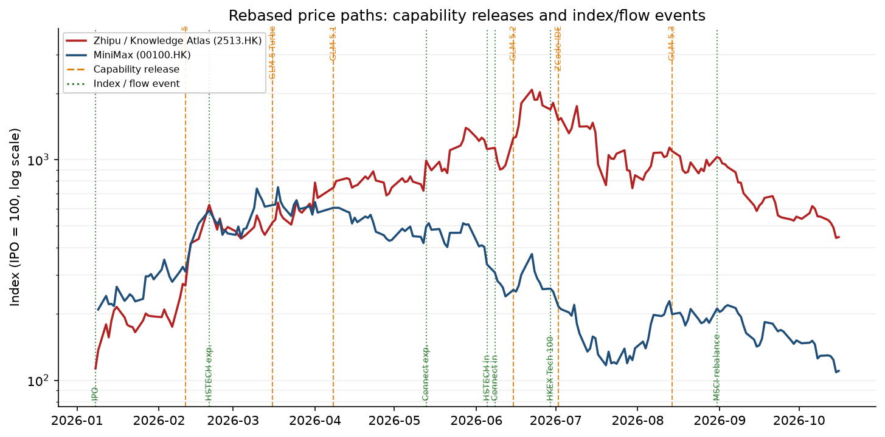
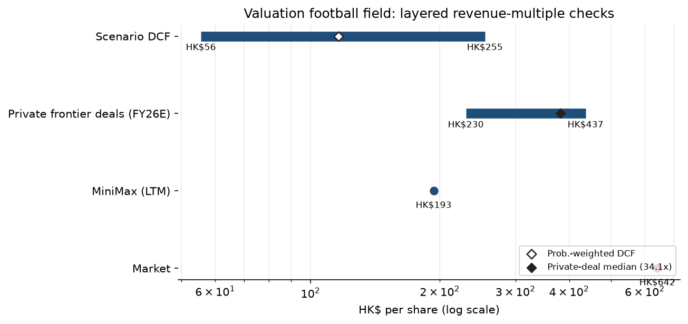
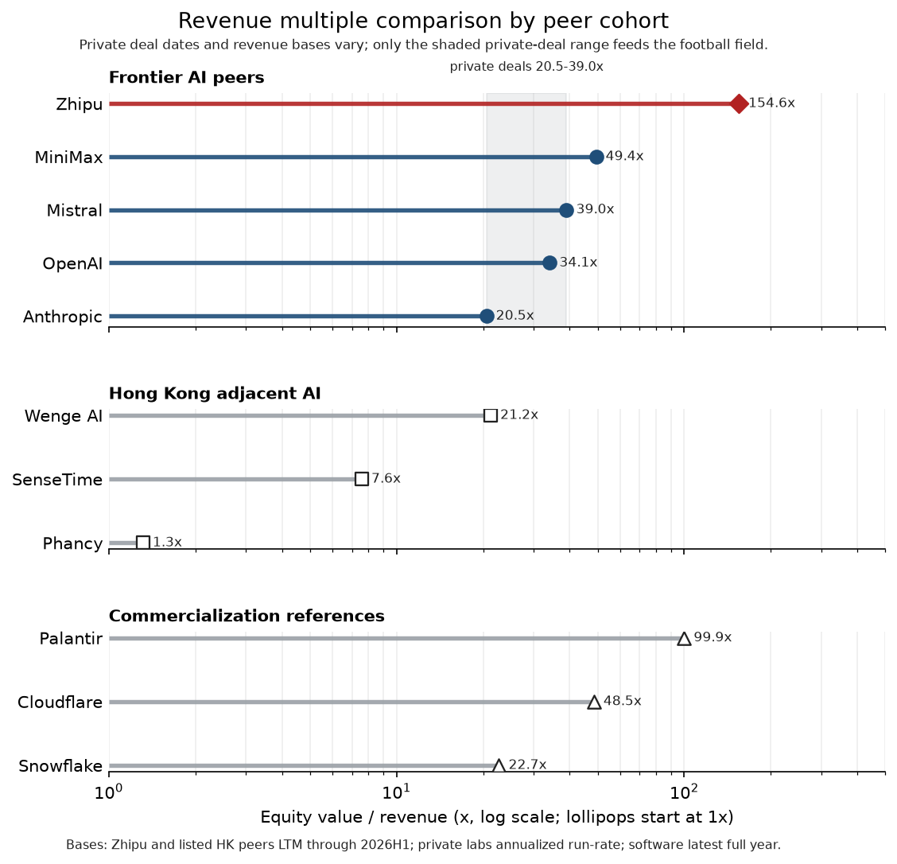
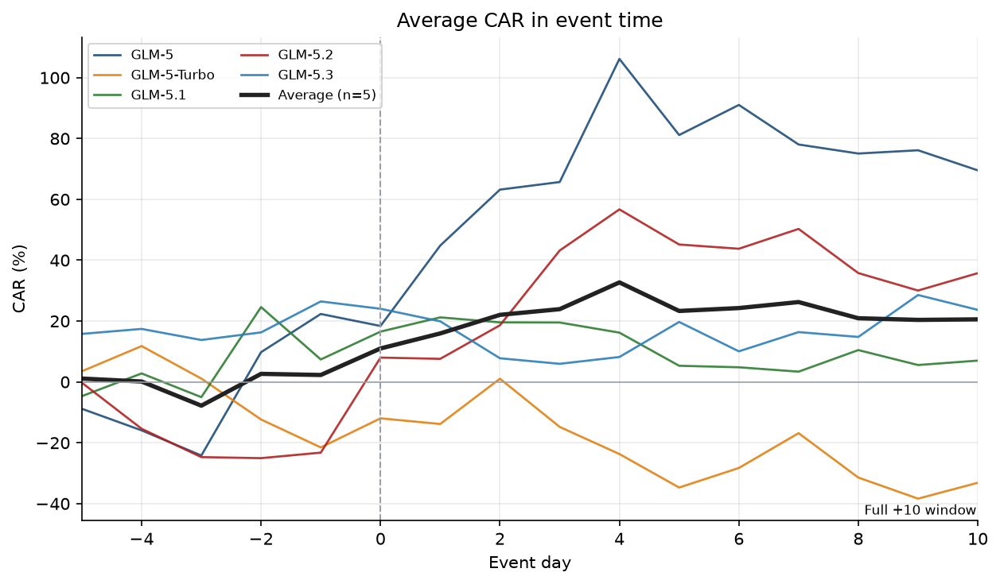
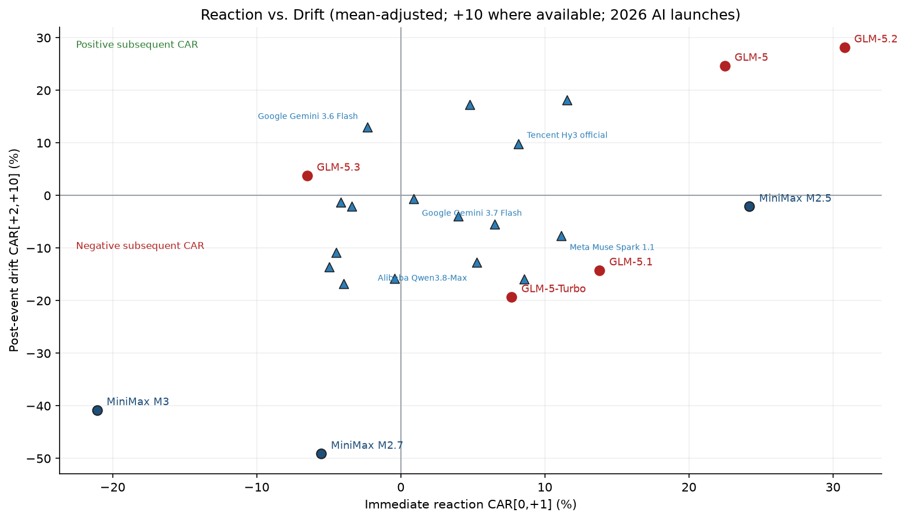

# 智谱 AI 估值与能力惊喜事件研究 | Zhipu AI Valuation and Capability-Surprise Event Study

<p align="center">
  <a href="#中文"></a>
  &nbsp;
  <a href="#english"></a>
</p>

<p align="center">
  <strong>Zhesheng Xu（许哲圣）</strong><br>
  Corporate Finance Final Project<br>
  <strong>信息截止 / Information cutoff</strong> 2026-10-14 · <strong>行情 / Prices</strong> 2026-10-14
</p>

<p align="center">
  <a href="paper/main.pdf"><strong>完整论文 / Paper</strong></a> ·
  <a href="model/valuation_model.xlsx"><strong>估值模型 / Model</strong></a> ·
  <a href="presentation/zhipu_beamer.pdf"><strong>演示文稿 / Slides</strong></a> ·
  <a href="data/valuation_comps.csv"><strong>可比口径 / Comparable Data</strong></a> ·
  <a href="anthropic/2026-10-11/README.md"><strong>Anthropic 底稿 / Working Papers</strong></a>
</p>

---

## 中文

### 项目概览

这个项目从一个具体的估值难题开始。智谱 AI 于 2026 年 1 月 8 日成为全球首家上市的基础模型公司。10 月 14 日收盘，公司市值约为 358 亿美元。8 月 31 日收盘后发布的半年业绩显示，H1 收入同比增长 399.7% 至人民币 9.54 亿元，开放平台与 API 已占收入的 86.5%。商业化正在加速，但经营亏损仍扩大至人民币 21.47 亿元，经调整净亏损也同比扩大 12.1%。研究重点随之落在市场为这种增长预付了多少。

我把披露事实与预测假设分开。公司没有提供全年收入指引；FY2026E 的 7 亿美元来自 H1 实际收入和 8 月经营节奏，属于模型估计。2026 年经营利润率取 −100%，较 H1 的 −225% 假定了明显改善。在此基础上，我用 CAPM/WACC、三情景 DCF、反向 DCF 与分层可比估值交叉检验。概率加权 DCF 约为每股 HK$116，10 月 14 日收盘价为 HK$572.0。反向 DCF 显示，若要支撑现价，2035 年收入需接近 421 亿美元。

估值结果说明市场预期有多高，事件研究继续考察价格怎样吸收新信息。我把模型发布和榜单跃升定义为“能力惊喜”，独立确定五个 GLM 事件日期，再用 MiniMax 做同业调整。五次事件的原始两日平均反应为 13.7%，同业调整后为 15.3%，后者位于区块 bootstrap 零假设分布的第 99.2 百分位。后续同业调整漂移虽为 16.8%，仍落在该零假设分布的 95% 区间内，持续漂移尚未得到统计支持。

样本只覆盖智谱上市后的前八个月和五个能力事件。本文把结果视为一个本科案例中的诊断性证据，不据此推断普遍的市场异象。完整模型、逐行可比口径、事件结果和重建脚本都保留在仓库中。

### 我完成的工作

| 研究环节 | 具体工作 | 可核查成果 |
|---|---|---|
| 基本面估值 | 建立 CAPM/WACC、三情景 DCF、敏感性分析和反向 DCF | [活公式估值模型](model/valuation_model.xlsx) |
| 相对估值 | 分开基础模型实验室、港股邻近公司与成熟 AI 软件公司，并统一记录估值日和收入口径 | [逐行可比数据](data/valuation_comps.csv) |
| 事件研究 | 独立确定模型发布日期，计算原始与同业调整 CAR，并检查反转、漂移和非能力事件 | [事件研究结果](eventstudy/event_panel_summary.csv) |
| 可复算设计 | 把主要表格、图形和论文构建过程写入脚本，并增加输出校验 | [构建脚本](scripts/build_project.py) · [校验脚本](scripts/validate_outputs.py) |

### 阅读入口

| 阅读时间 | 建议入口 |
|---|---|
| 约 1 分钟 | 继续阅读本页的[估值结论](#估值结论)和[事件研究](#事件研究) |
| 约 10 分钟 | 查看[演示文稿](presentation/zhipu_beamer.pdf) |
| 完整阅读 | 打开[论文 PDF](paper/main.pdf) |
| 核查假设 | 打开[估值模型](model/valuation_model.xlsx)和[数据来源](#数据来源) |

### 研究问题

> 对一家尚无稳定盈利的基础模型公司，怎样建立可解释的估值边界？模型能力信息进入股价后，短窗反应和后续漂移呈现什么特征？

经典事件研究常以“盈余惊喜”为信息事件（Ball 与 Brown，1968；Bernard 与 Thomas，1989）。前沿大模型公司仍在深度亏损，短期盈余很难承载投资者最关心的信息。本文把模型发布和基准榜单跃迁定义为“能力惊喜”，并把国信证券《超预期投资全攻略》（2020）的 CAR 三窗口框架用于这一新资产类别。

### 研究设计

| 研究环节 | 方法 | 研究用途 |
|---|---|---|
| 基本面估值 | CAPM/WACC、三情景 DCF、反向 DCF、可比公司和实物期权 | 给出现金流价值范围，并还原市价隐含的经营路径 |
| 能力事件研究 | GLM-5 至 GLM-5.3 五个事件，以 MiniMax 作同业调整 | 观察模型能力信息进入股价后的即时反应与后续漂移 |

### 2026H1 半年业绩更新

[港交所中期业绩公告](https://www1.hkexnews.hk/listedco/listconews/sehk/2026/0831/2026083101539.pdf)于 8 月 31 日收盘后发布，数据未经审计并由 KPMG 审阅。

| 指标 | 2026H1 | 2025H1 | 同比变化 |
|---|---:|---:|---:|
| 收入 | RMB 953.9M | RMB 190.9M | +399.7% |
| 毛利 | RMB 251.6M | RMB 95.4M | +163.7% |
| 总毛利率 | 26.4% | 50.0% | −23.6ppt |
| 开放平台与 API 收入 | RMB 825.2M，占 86.5% | RMB 29.1M，占 15.2% | +2,735.7% |
| API 毛利率 | 24.6% | −0.4% | 约 +25ppt |
| 经营亏损 | RMB 2,146.6M | RMB 1,899.2M | 扩大约 13.0% |
| 经调整净亏损 | RMB 1,964.1M | RMB 1,752.0M | 扩大 12.1% |

收入结构已经从本地部署转向调用和订阅，API 毛利率也转正。与此同时，应收款、算力预付款和研发投入继续上升。报告中的净亏损收窄来自毛利增加和投资者金融工具相关损失大幅下降，经营亏损和经调整净亏损仍在扩大，因此本文没有把 headline 写成“盈利改善”。9 月 24 日盘后的[正式中期报告](https://www.hkexnews.hk/listedco/listconews/sehk/2026/0924/2026092401584_c.pdf)补齐现金流：H1 经营现金净流出人民币 33.74 亿元。附注 14 显示账面现金含人民币 1.06 亿元受限资金，本期估值现金桥已扣除。

### MiniMax 2026H1 同业更新

[MiniMax 中期业绩公告](https://www1.hkexnews.hk/listedco/listconews/sehk/2026/0826/2026082600680.pdf)于 8 月 26 日收盘后发布。H1 收入同比增长 283.1% 至 US$116.6M，开放平台和企业服务收入增长 703.1% 至 US$73.9M、占收入 63.4%；毛利率由 12.1% 升至 17.9%。但经调整净亏损从 US$138.7M 扩大到 US$293.0M，说明商业化提速仍伴随高研发投入。估值可比中的 US$165.2M LTM 收入，按 FY2025 收入减去 2025H1、再加 2026H1 计算，而不是把半年收入简单年化。

### 本期走势与产品信任

9 月 30 日至 10 月 14 日，智谱从 HK$641 降至 HK$572.0（−10.76%），MiniMax 从 HK$250.2 降至 HK$204.2（−18.39%），中科闻歌从 HK$63.85 降至 HK$61.85（−3.13%）。三者相对 8 月末仍分别回撤 52.13%、41.49% 和 28.08%。价格变化不能单独识别能力、融资或产品信任的因果作用。

10 月 2 日港交所月报确认智谱总股本为 487,588,090 股。9 月 30 日盘后公告授予 1,222,934 股奖励，尚未归属，九月未因此发行新股；10 月 9 日盘后仅补充绩效条件。已发行股本及原现金桥保留，未把尚未归属奖励直接当作新增已发行股份。

9 月 18 日晚间回应与 CLI 消息对应的 9 月 21 日窗口，现已具备完整九日漂移；9 月 24 日盘后报告和周末预览窗口也已具备完整九日漂移；10 月 2 日奖励窗口只有七日漂移。原五事件与 bootstrap 保持 8 月 31 日边界，新增结果单列。十月促销期虽已过去，实际收入影响仍未独立核验。来源见[证据表](data/current_evidence.csv)。

ZCode 官方桌面更新页已列出 10 月 12 日 v3.15.1（HighSpeed 随机试用、权限与工作流改动）及 13 日 v3.15.3（更新、登录和并行请求修复）。GitHub 的 v3.14.3 源码发布与桌面版本日期不同，不能混用。未披露相关收入和留存影响，经营预测不据此提高。

### 估值结论

行情更新至 10 月 14 日；原经营预测与 8 月末 beta 保留。九月配售已于 16 日完成，可转债于 18 日发行，股本升至 4.876 亿股。现金桥扣除六月受限资金，再加上两笔融资净款，同时扣除约 US$3,000.64m 的可转债发行时点本金代理值，得到 US$6,292.9m。该债务代理值按美元总款除以 100.5% 发行价计算，并非公允价值；净现金桥也未扣除未披露的期后消耗。WACC 保留 13.5%，汇率假设 HK$7.8/US$、RMB7.1/US$。活公式见 [`model/valuation_model.xlsx`](model/valuation_model.xlsx)，十年完整 Base Case 见论文附录 B。

| 情景 | 收入 CAGR 2026 至 2035 | 终期利润率 | 股权价值 | 每股（HK$） |
|---|---|---|---|---|
| 悲观 (p=0.35) | 23% | 18% |  $3.5B | 56 |
| 中性 (p=0.45) | 31% | 28% | $6.3B | 102 |
| 乐观 (p=0.20) | 47% | 35% | $15.9B | 255 |
| **概率加权** | N/A | N/A | **$7.3B** | **116** |
| *市价 (2026-10-14，收盘)* | N/A | N/A | *$35.8B* | *572.0* |

**反向 DCF** 固定 FY2026E 收入后重新求解增长路径。要支撑现价，2035 年收入需接近 **US$421 亿**，对应 2026 至 2035 年约 **57.6%** 的年复合增速。这项结果只用于呈现市价隐含条件。敏感性分析中，10% WACC 与 50% 终期利润率对应约 US$126 亿收入，15% WACC 与 40% 利润率对应约 US$600 亿；隐含收入对折现率与利润率假设很敏感。

**分层可比** 对两家上市基础模型公司采用同一规则：2026 年 10 月 14 日市值除以截至 2026H1 的 LTM 实际收入。智谱 LTM 收入为人民币 14.87 亿元（FY2025 减 2025H1、再加 2026H1），按 RMB7.1/US$ 折合 US$209.5M，对应 **170.7×**；MiniMax LTM 收入为 US$165.2M，对应 **55.3×**。

OpenAI、Anthropic 与 Mistral 的私有交易参照更接近基础模型实验室的业务形态，因此它们构成 football field 的核心交易区间。倍数落在 **20.5 至 39.0×**，中位数为 **34.1×**；由于私企只能取得同期收入 run-rate，这组交易参照仍单独应用于智谱 FY2026E，得到每股约 HK$230 至 437。统一 LTM 口径后，MiniMax 倍数对应智谱约 HK$185.5，较市价低 67.6%。最接近的上市同业不再能解释智谱的大部分市值，智谱相对 MiniMax 仍有约 3.1 倍的收入倍数溢价。

SenseTime、Phancy 和中科闻歌放在港股邻近组。Palantir、Cloudflare 和 Snowflake 放在商业化参照组。它们能帮助读者判断港股 AI 资产和成熟 AI 软件的估值位置，商业模式与收入结构却和基础模型实验室差别很大，因此不参与核心中位数。逐行口径、估值日和来源见 [`data/valuation_comps.csv`](data/valuation_comps.csv)。

### Anthropic 商业化与估值方法对照

Anthropic 的现金流与收入倍数框架用于说明能力如何转化为商业收入，以及不同估值方法如何依赖经营假设。该伴随模型已独立复算。信息截止 10 月 14 日，估值日假设为 2026 年 12 月 31 日；2027—2036 年为显式预测期，2037 年起为终值。2028 年收入取报道预测中点 US$195bn；假设 10× 前瞻收入给出 US$1.95tn EV，12% WACC、3% 永续增长下 DCF EV 为 US$788.5bn，终值占 57.2%。

2026 年 US$64bn 收入锚、10× 倍数、利润率与现金桥均为模型假设。报道的约 US$2tn IPO 股权目标尚非成交价格，不替换原可比表中已完成的 US$965bn 融资。这项对照用于解释估值方法和商业转化条件，不构成智谱的额外目标价，也没有为智谱事件研究提供独立实证验证。10 月 14 日官方新加坡办公室及政府合作公告补充了商业化案例；未披露可直接代入模型的新增收入。三季度收入的 Reuters 报道发布时已是北京时间 15 日，未纳入 14 日信息集。完整假设与来源见[Anthropic 对照说明](ANTHROPIC_COMPARISON.md)。

### 事件研究

本节保留截至 8 月 31 日的原始五事件样本及 bootstrap；九月至十月新增可观察窗口另见 [新增事件窗口](eventstudy/october_window_update.csv)。

把模型发布/榜单事件当作信息事件，计算累计异常收益（CAR，均值调整；以 MiniMax 为基准做同业调整稳健性）。

| 事件 | Day 0 | 反应[0,+1] | 漂移[+2,+10] | 读数 |
|---|---|---|---|---|
| GLM-5 | 2026-02-11 | +22.5% | +24.7% | 正反应后继续上行 |
| GLM-5-Turbo | 2026-03-16 | +7.7% | −19.3% | 反转 |
| GLM-5.1 | 2026-04-08 | +13.8% | −14.2% | 正反应后回撤 |
| GLM-5.2 | 2026-06-15 | +30.8% | +28.2% | 正反应后继续上行 |
| GLM-5.3 | 2026-08-14 | −6.5% | +3.8% | 信息可能提前进入价格，同业调整后为正 |
| MiniMax M2.5 | 2026-02-12 | +24.2% | −2.1% | 发布当期获正面定价，后续基本持平 |
| MiniMax M2.7 | 2026-03-18 | −5.5% | −49.1% | 反应较弱，随后估值收缩 |
| MiniMax M3 | 2026-06-01 | −21.1% | −40.8% | 发布后估值收缩 |
| **均值(5)** | | **+13.7%** | **+4.6%** | |

均值调整采用 `AR_t = R_t - average(R[-20,-6])`。截至原样本截止日 2026-08-31，GLM-5.2 与 GLM-5.3 的 [+2,+10] 窗口均覆盖完整 9 个交易日。GLM-5.3-Flash 只有三个后续交易日，因此只进入扩展目录。H1 业绩公告于 8 月 31 日 18:56 收盘后发布，也只列入财务披露目录；当天 +9.63% 的涨幅不能写成“财报发布后的反应”。

事件日期独立取自官方发布公告，没有按股价走势倒推。原始短窗五次中有四次为正，均值为 +13.7%。同业调整后，五次反应与后续漂移均为正，均值分别为 +15.3% 和 +16.8%。区块 bootstrap 将反应均值置于零假设分布的第 99.2 百分位，但漂移仍落在 95% 区间内。因此，样本支持能力事件附近的即时重定价，尚不足以确认持续漂移。表中的上行和回撤只描述各事件的收益路径。2 月 20 日与 5 月 13 日的尖峰来自指数调整和资金流事件，未计为能力事件。

MiniMax 的主线事件现补齐 M2.5（2 月 12 日）、M2.7 和 M3。H3（7 月 31 日）与 Music 3.0（8 月 13 日）保留在扩展目录，但不进入 Table 2：前者以音视频生成作为主要输出，后者是音乐垂类模型，与文本、编码和 Agent 能力事件不在同一口径。MiniMax 半年报也作为财务披露事件列入目录；由于 8 月 26 日收盘后发布，截至 8 月 31 日没有完整漂移窗口，不计算 CAR。

论文 Table 2 另列出 16 个具备完整窗口、且模型发布方本身存在可交易股票的大型科技厂商事件。7—8 月新增腾讯 Hy3、阿里 Qwen3.8-Max、Google Gemini 3.6/3.7 Flash 和 Meta Muse Spark 1.1。Microsoft 代 OpenAI、Tesla 代 xAI 的 6 条代理事件已从 CAR 表和均值中移除，只留在审计目录；在原 8 月 31 日截止日没有完整后窗的 Qwen3.8-Flash、腾讯 Hy4 和 Gemini Transcribe/Omni 1.1 同样只进入目录。

样本只有五个事件，上市历史也很短。即时重定价的证据适用于本案例，不能据此推断所有基础模型公司都存在同样的价格反应。

### 港股 AI 参照公司

截至 2026 年 10 月 14 日，港股 AI 参照公司可按业务分为基础模型实验室和企业 AI 平台。

| 公司 | 代码 | 定位 | 上市表现 |
|---|---|---|---|
| 智谱AI | 2513.HK | 通用基础大模型实验室 | IPO HK$116.20 → HK$572.0（+392%） |
| MiniMax | 00100.HK | 通用/多模态基础模型公司 | IPO HK$165 → HK$204.2（+24%，首日翻倍后曾明显回落） |
| SenseTime 商汤 | 00020.HK | 生成式 AI、计算机视觉与解决方案平台 | 2026-10-14 收盘 HK$1.19，约 7.8× LTM 收入 |
| Phancy 范式智能 | 06682.HK | 企业 AI 平台与智能体服务 | 2026-10-14 收盘 HK$24.12，约 1.4× LTM 收入 |
| 中科闻歌 Wenge AI | 01956.HK | 企业级决策大模型与 AI 解决方案商 | IPO HK$60.70 → HK$61.85（+2%）；约 20.3× LTM 收入 |

> *Recent Hong Kong AI listings include foundation-model laboratories such as Zhipu AI and MiniMax, as well as enterprise-focused AI platforms. Wenge AI is an enterprise decision-intelligence provider and belongs in the Hong Kong-adjacent cohort.*

中科闻歌由中科院自动化所团队 2017 年创立，主打 DIOS 决策智能操作系统与 Decitron、雅意等模型，2025 年中国企业级决策智能大模型市场收入第一（~10.2% 份额）。SenseTime、Phancy 和中科闻歌都保留在港股邻近组。它们的收入结构与基础模型实验室差别很大，因此只展示倍数，不参与核心中位数。

### 关键图表

<p align="center"></p>
<p align="center"></p>
<p align="center"></p>
<p align="center"></p>
<p align="center"></p>

### 数据来源

来源按以下顺序取舍。**HKEX 招股书与公告 > 官方模型卡和技术报告 > 恒生指数公司公告 > 正式市场数据库**。新闻媒体只作交叉核对。

- **行情** 使用 Tushare `hk_daily`。频率或权限受限时，以腾讯财经港股日线和 Nasdaq 美股日线补齐并交叉核对，见 [`data/`](data/)。
- **财务** 使用港交所第 18C 章招股书、2025 年报和 2026H1 中期业绩公告；智谱与 MiniMax 的结构化口径分别见 [`data/zhipu_financials_input.csv`](data/zhipu_financials_input.csv) 和 [`data/minimax_financials_input.csv`](data/minimax_financials_input.csv)。智谱正式中期报告于 9 月 24 日盘后发布，现金流及受限现金已录入。
- **估值可比** 输入表与生成表分别见 [`data/valuation_comps_input.csv`](data/valuation_comps_input.csv) 和 [`data/valuation_comps.csv`](data/valuation_comps.csv)，逐行保留估值日、收入周期、币种和来源。
- **股本与配售** 使用 6 月月报及 7 月 13 日配售完成公告。七月股本为 465,623,090 股，九月再新增 21,965,000 股至 487,588,090 股；完成公告见本周核验。
- **能力事件** 使用 GLM 和 MiniMax 官方模型卡、ZCode 发布记录与 SWE-Bench Pro 等榜单。
- **指数和资金流** 使用恒生指数公司指数调整公告与 HKEX、SSE 港股通名单。

> ⚠️ Tushare token 仅通过环境变量传入，切勿写入代码或提交到仓库；无权限时可运行公开来源回退模式。

### 项目结构

```text
.
├── paper/                 # 论文 XeLaTeX 源 (main.tex) 与 main.pdf
├── 42353012_许哲圣_*.pdf   # 按"学号_姓名_论文名"命名的提交版 PDF
├── model/                 # 活公式估值模型 valuation_model.xlsx
├── eventstudy/            # 事件研究 CAR 结果与 Base Case 预测 (csv)
├── figures/               # 论文/README 图表
├── data/                  # 行情与分层估值可比口径 CSV
├── OUTLINE.md / DATA_TABLES.md / EVENT_STUDY.md  # 过程文档
```

本次文章修订不设字数上限。常规校验仍保留课程字数限制；检查本次扩展稿时使用 `python scripts/validate_outputs.py --ignore-word-limits`。

### 如何编译

```bash
python scripts/build_project.py
```

手动等价命令

```bash
cd paper
python ../scripts/rebuild_outputs.py
python ../scripts/comps_beta_and_reverse_dcf.py
# 需 TeX Live + XeLaTeX（封面含中文，必须用 xelatex；参考文献为内嵌 APA 列表，无需 bibtex）
xelatex -interaction=nonstopmode main.tex
xelatex -interaction=nonstopmode main.tex
cd ..
python scripts/validate_outputs.py
```

---

## English

### Project Overview

Information is reviewed through October 14 (Beijing time), with all 11 daily series ending on October 14, 2026 by local exchange date. Since September 30, Zhipu lost 10.76%, MiniMax lost 18.39%, and Wenge AI lost 3.13%. The monthly return confirms Zhipu's existing share count. Newly observed windows remain separate from the fixed August cohort. The supplied Anthropic workbook is archived and independently reproduced; heterogeneous peer multiples remain reference-only. See the [source evidence](data/current_evidence.csv).


I built this project around a valuation problem that conventional earnings-surprise analysis handles poorly. Zhipu AI listed under 2513.HK on 8 January 2026, becoming the first publicly traded foundation-model laboratory. By the close on 14 October, its market capitalization was approximately US$35.8 billion. Results released after the 31 August close showed H1 revenue of RMB953.9 million, up 399.7 percent, with open-platform and API sales contributing 86.5 percent. Operating loss nevertheless widened to RMB2.15 billion, and adjusted net loss increased by 12.1 percent. The central question is therefore measurable: how much future operating performance has the market already paid for?

The project asks what investors are pricing when near-term earnings provide little information. I use a three-scenario DCF, reverse DCF, layered comparables and a real-options interpretation to establish a fundamental range. I then define model releases and benchmark gains as capability-surprise events and run a peer-adjusted event study using MiniMax as the comparison firm.

I separate reported facts from forecast choices. The company gave no full-year revenue guidance; the model's US$700 million FY2026E revenue uses H1 actuals and the August run-rate, while a −100 percent FY2026 operating margin assumes substantial improvement from the reported H1 margin of −225 percent. The probability-weighted DCF is about HK$116 per share, or 20.3 percent of the HK$572.0 October 14 close. The reverse DCF requires roughly US$42.1 billion of 2035 revenue, a 57.6 percent compound annual growth rate from the FY2026E base. These outputs describe the assumptions embedded in the price rather than a price target.

The event study covers five independently dated GLM events from GLM-5 through GLM-5.3. The average two-day reaction is 13.7 percent before peer adjustment and 15.3 percent after adjustment. The adjusted reaction lies at the 99.2nd percentile of the block-bootstrap null distribution. Adjusted subsequent drift averages 16.8 percent but remains within the null distribution's 95 percent interval, so durable drift is not statistically established. The sample covers one company during its first eight months as a listed firm, so I present the result as diagnostic evidence from an undergraduate case. It cannot establish a general market anomaly.

### Work Completed

| Research step | Work performed | Auditable output |
|---|---|---|
| Fundamental valuation | Built the CAPM/WACC bridge, three-scenario DCF, sensitivity analysis and reverse DCF | [Live-formula model](model/valuation_model.xlsx) |
| Relative valuation | Separated frontier laboratories, Hong Kong adjacent firms and mature AI software companies; recorded the valuation date and revenue basis for each row | [Comparable-company data](data/valuation_comps.csv) |
| Event study | Dated releases independently, calculated raw and peer-adjusted CARs, and separated capability events from index and flow events | [Event-study results](eventstudy/event_panel_summary.csv) |
| Reproducibility | Connected the main tables, figures and paper to build scripts and output checks | [Build script](scripts/build_project.py) · [Validation script](scripts/validate_outputs.py) |

### Where to Start

| Time available | Suggested entry point |
|---|---|
| About 1 minute | Read the [valuation results](#valuation-summary-market-row-at-2026-10-14) and [event study](#event-study) |
| About 10 minutes | Open the [presentation](presentation/zhipu_beamer.pdf) |
| Full review | Read the [paper](paper/main.pdf) |
| Assumption check | Inspect the [valuation model](model/valuation_model.xlsx) and [comparable-company data](data/valuation_comps.csv) |

### Research Question and Design

How can a defensible valuation range be built for a foundation-model company without stable earnings? Once capability information reaches the market, what do the short-window reaction and subsequent drift look like?

| Research step | Method | Purpose |
|---|---|---|
| Fundamental valuation | CAPM/WACC, three-scenario DCF, reverse DCF, comparables and real options | Establish a cash-flow range and recover the operating path embedded in the market price |
| Capability event study | Five events from GLM-5 through GLM-5.3 with MiniMax peer adjustment | Observe the immediate reaction and subsequent drift following capability information |

### H1 2026 Results Update

The [HKEX interim-results announcement](https://www1.hkexnews.hk/listedco/listconews/sehk/2026/0831/2026083101539.pdf) was released after the 31 August close. The figures are unaudited and were reviewed by KPMG.

| Metric | H1 2026 | H1 2025 | Change |
|---|---:|---:|---:|
| Revenue | RMB953.9M | RMB190.9M | +399.7% |
| Gross profit | RMB251.6M | RMB95.4M | +163.7% |
| Total gross margin | 26.4% | 50.0% | −23.6ppt |
| Open-platform and API revenue | RMB825.2M, 86.5% of total | RMB29.1M, 15.2% | +2,735.7% |
| API gross margin | 24.6% | −0.4% | approximately +25ppt |
| Operating loss | RMB2,146.6M | RMB1,899.2M | widened approximately 13.0% |
| Adjusted net loss | RMB1,964.1M | RMB1,752.0M | widened 12.1% |

The mix has shifted decisively from on-premise deployment toward API usage and subscriptions, and API gross margin turned positive. Receivables, compute-service prepayments and R&D spending also increased. Reported net loss narrowed as gross profit rose and investor-instrument losses fell sharply; operating loss and adjusted net loss both widened. The [formal interim report](https://www.hkexnews.hk/listedco/listconews/sehk/2026/0924/2026092401584_c.pdf), released after the September 24 close, adds H1 operating cash outflow of RMB3,374.1M. Note 14 identifies RMB106.0M of restricted deposits. The valuation cash bridge now excludes these deposits; H1 cash burn is already reflected in June cash and is not deducted twice.

### MiniMax H1 2026 Peer Update

MiniMax released its [interim results](https://www1.hkexnews.hk/listedco/listconews/sehk/2026/0826/2026082600680.pdf) after the 26 August close. Revenue rose 283.1 percent to US$116.6 million, while Open Platform and enterprise-service revenue rose 703.1 percent to US$73.9 million, or 63.4 percent of the total. Gross margin improved from 12.1 to 17.9 percent, but adjusted net loss widened from US$138.7 million to US$293.0 million. The US$165.2 million LTM revenue used in the peer multiple equals FY2025 revenue less H1 2025 plus H1 2026; it is not a simple annualisation of the latest half.

### Valuation Summary (market row at 2026-10-14)

WACC remains 13.5 percent for comparability. Shares are 487.588 million after the September placement. The US$6.293 billion pro forma bridge adds completed placement and bond proceeds to June unrestricted net cash and the July placement, and deducts an issue-date bond-principal proxy of US$3,000.64m (gross proceeds / 1.005). This is not IFRS fair value or a reported September cash balance and excludes undisclosed subsequent cash burn. The live workbook is [`model/valuation_model.xlsx`](model/valuation_model.xlsx), and the paper's Appendix B contains the full ten-year Base case.

| Scenario | Revenue CAGR 2026 to 2035 | Terminal margin | Equity value | Per share (HK$) |
|---|---|---|---|---|
| Bear (p=0.35) | 23% | 18% |  $3.5B | 56 |
| Base (p=0.45) | 31% | 28% | $6.3B | 102 |
| Bull (p=0.20) | 47% | 35% | $15.9B | 255 |
| **Probability weighted** | N/A | N/A | **$7.3B** | **116** |
| *Market (2026-10-14, close)* | N/A | N/A | *$35.8B* | *572.0* |

**Reverse DCF** fixes the FY2026E base and solves for the growth path required by the observed price. It points to approximately US$42.1 billion of 2035 revenue, equivalent to roughly 57.6 percent annual growth from 2026 through 2035. At 10 percent WACC and a 50 percent terminal margin, required revenue is about US$12.6 billion; at 15 percent WACC and a 40 percent margin, it is about US$60.0 billion.
For the two listed foundation-model companies, the comparison now uses one rule: 14 October 2026 equity value divided by LTM revenue through 2026H1. Zhipu's RMB1,487.3 million LTM revenue, equal to FY2025 less H1 2025 plus H1 2026, translates to US$209.5 million at RMB7.1/US$ and gives **170.7×**. MiniMax remains at **55.3×** on US$165.2 million of LTM revenue.
Paired private-market references for OpenAI, Anthropic, and Mistral run from **20.5× to 39.0×**, with a **34.1× median**.
The private range still applies to Zhipu's FY2026E revenue because the private-company observations use contemporaneous revenue run-rates; it implies approximately HK$230 to HK$437 per share. Applying MiniMax's LTM multiple to Zhipu's LTM revenue gives about HK$185.5, 67.6 percent below the market. On the uniform listed-company basis, Zhipu trades at roughly 3.1 times MiniMax's revenue multiple, so the peer no longer explains most of the quote.
SenseTime, Phancy, and Wenge AI form a separate Hong Kong-adjacent cohort, while Palantir, Cloudflare, and Snowflake are commercialization references. Neither cohort enters the private-deal range. Row-level bases and sources are in [`data/valuation_comps.csv`](data/valuation_comps.csv).

### Anthropic commercialization and valuation illustration

The companion model illustrates how capability can translate into commercial revenue and how valuation methods depend on operating assumptions. It is reproduced separately: information cutoff October 14, assumed valuation date December 31, 2026, explicit UFCF in 2027–2036 and terminal value from 2037. A reported 2028 revenue midpoint of US$195bn and an assumed 10× forward multiple imply US$1.95tn EV, versus US$788.5bn DCF EV at 12% WACC and 3% terminal growth. The reported US$2tn IPO equity target does not replace the completed May funding reference. It supplies neither an additional Zhipu price target nor independent empirical validation of the Zhipu event study. See the [method comparison](ANTHROPIC_COMPARISON.md).

### Event Study

This section preserves the original August 31 five-event cohort and bootstrap. Newly observable windows are reported separately in the [supplementary event windows](eventstudy/october_window_update.csv).

| Event | Day 0 | Reaction [0,+1] | Drift [+2,+10] | Reading |
|---|---|---|---|---|
| GLM-5 | 2026-02-11 | +22.5% | +24.7% | positive reaction followed by further gains |
| GLM-5-Turbo | 2026-03-16 | +7.7% | −19.3% | reversal |
| GLM-5.1 | 2026-04-08 | +13.8% | −14.2% | positive reaction followed by a pullback |
| GLM-5.2 | 2026-06-15 | +30.8% | +28.2% | positive reaction followed by further gains |
| GLM-5.3 | 2026-08-14 | −6.5% | +3.8% | anticipated; positive peer-adjusted reaction |
| MiniMax M2.5 | 2026-02-12 | +24.2% | −2.1% | positive launch reaction; little subsequent drift |
| MiniMax M2.7 | 2026-03-18 | −5.5% | −49.1% | muted / de-rate |
| MiniMax M3 | 2026-06-01 | −21.1% | −40.8% | negative reaction followed by further losses |
| **Average (5)** | | **+13.7%** | **+4.6%** | |

The mean-adjusted return is defined as `AR_t = R_t - average(R[-20,-6])`. As of the original 2026-08-31 sample cutoff, GLM-5.2 and GLM-5.3 both have complete nine-day [+2,+10] windows. GLM-5.3-Flash has only three subsequent trading days and remains in the extended catalog. The H1 results announcement was released at 18:56 after the 31 August close, so that day's 9.63 percent gain predates the disclosure and is not treated as an earnings reaction.

The event dates come from official release announcements and were set independently of the share-price path. Mean reaction rises from +13.7 percent before adjustment to +15.3 percent after peer adjustment. Subsequent drift rises from +4.6 percent to +16.8 percent, and all five adjusted reaction and drift windows are positive. The block bootstrap places the adjusted reaction at the 99.2nd percentile of the null distribution, while adjusted drift remains inside its 95 percent interval. This supports immediate repricing around capability events; the evidence does not establish durable drift. Table readings describe the return paths. The spikes on 20 February and 13 May are index and flow events linked to Hang Seng Tech inclusion and Stock Connect.

The MiniMax peer series now includes M2.5 (12 February), M2.7 and M3. H3 (31 July) and Music 3.0 (13 August) remain in the extended catalog but outside Table 2 because their audio-video and music outputs are not comparable with the text, coding and agent events in the core sample. MiniMax's results announcement is also catalogued as a financial disclosure, but its post-event window is incomplete at the cutoff.

Paper Table 2 also reports 16 complete-window large-tech events for which the model issuer itself has a traded security. The July-August refresh adds Tencent Hy3, Alibaba Qwen3.8-Max, Google Gemini 3.6/3.7 Flash and Meta Muse Spark 1.1. Six Microsoft-for-OpenAI and Tesla-for-xAI proxy events have been removed from the CAR table and its average, while remaining visible in the audit catalog. Qwen3.8-Flash, Tencent Hy4 and Gemini Transcribe/Omni 1.1 also remain catalog-only because their post-event windows were incomplete at the original August 31 cutoff.

The five-event sample and short listing history limit the immediate-repricing result to this case. They do not establish a general market anomaly.

### Repository Structure

```text
.
├── paper/      # Thesis XeLaTeX source (main.tex) and main.pdf
├── 42353012_许哲圣_*.pdf   # submission PDF named 学号_姓名_论文名
├── model/      # Live-formula valuation model
├── eventstudy/ # CAR results + Base-case projection (csv)
├── figures/    # Figures
└── data/       # Tushare / Tencent Finance / Nasdaq market-data CSVs
```

This article revision has no word-count cap. The default validator retains the course limits; use `python scripts/validate_outputs.py --ignore-word-limits` to check the expanded draft.

### October refresh

`python scripts/refresh_1011.py` rebuilds the valuation snapshot from staged market data; `python scripts/anthropic_ipo_crosscheck.py` reproduces the latest companion assumptions. Workbook edits use the bundled artifact-tool; PDF outputs use local XeLaTeX. The original August event sample remains fixed.

### How to Build

```bash
python scripts/build_project.py
```

Quick checks

```bash
python -m unittest discover -s tests
python scripts/validate_outputs.py
```

Manual equivalent

```bash
cd paper
python ../scripts/rebuild_outputs.py
python ../scripts/comps_beta_and_reverse_dcf.py
# XeLaTeX required (CJK cover); references are an inline APA list, so no bibtex step
xelatex -interaction=nonstopmode main.tex
xelatex -interaction=nonstopmode main.tex
cd ..
python scripts/validate_outputs.py
```

> ⚠️ Pass any Tushare token only through an environment variable; the updater can use public fallbacks when permissions bind.

---

## License

MIT License, see [LICENSE](LICENSE). Copyright (c) 2026 Zhesheng Xu (许哲圣). Student ID 42353012.
